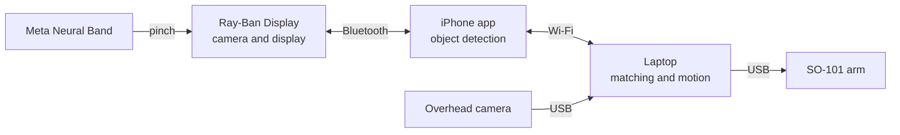

# Nabi

Look at an object on the table, pinch your fingers, and a robot arm picks it up and hands it to you.

Nabi is an open-source robot arm you control by looking and pinching, with nothing to hold and nothing to type. Meta Ray-Ban Display glasses see what you're facing, and the Meta Neural Band wristband picks up the pinch. The arm is the open-source SO-101. All of the parts together cost just under CA$2,000.

In November 2026 Nabi received a CA$2,000 grant from Western University to buy the parts, and the build is starting. The arm is not built yet. The repository holds the design, a priced parts list, a [build plan](docs/plan.md) with dates, an iPhone app in [`app/`](#iphone-app) that finds and names the object you're facing and the arm control setup in [`robot/`](robot/README.md). More code and CAD files will be added as the build goes on.

## Why

Telling a robot which object to pick up usually means a controller, a touchscreen or a typed command. Nabi tries something more direct: you look at the object and pinch. The glasses and wristband that make this possible are now consumer products.

The application with the most to gain is accessibility. For someone with limited reach, such as a wheelchair user with limited shoulder movement, a phone or a remote at the far side of a table often means asking someone else to pass it. Wheelchair-mounted assistive arms can do this, but they have been quoted at over $40,000 ([NIBIB](https://www.nibib.nih.gov/sites/default/files/R-ARM.pdf)). Research at the University of Utah, funded by Meta, found that wrist muscle signals could still drive a virtual hand for people who couldn't extend their fingers ([Meta](https://www.meta.com/en-gb/blog/university-of-utah-accessibility-research-meta-neural-band/)). Whether the Neural Band's pinch works as well for those users is one of the questions this project will test.

Choosing objects for a robot by looking at them is not a new idea. A 2018 system built from eye-tracking glasses, a depth camera and a robot arm completed 96% of its pick-and-place tasks ([arXiv:1809.08095](https://arxiv.org/abs/1809.08095)). It ran on lab equipment. Nabi tests whether off-the-shelf consumer hardware can now do the same job at a small fraction of the cost, with every design file published.

## How it works



1. The iPhone app streams video from the glasses and runs an object detector on it. The glasses have no eye tracking, so you aim with your head, like a red dot sight. The object behind the display becomes the candidate.
2. A dot and a label appear over that object in the glasses' display. The dot stays on it until it leaves the display or another object is more directly in front. A pinch locks it, and the dot stays on the object while the arm works.
3. A camera above the table finds the same object. Printed ArUco markers on the table turn its position in the image into table coordinates.
4. The arm reaches down, grips the object and carries it to a fixed handover point at table height.
5. When the user pinches again, the gripper opens. A pinch while the arm is moving stops it, and so does a stop button in the phone app.

The first version uses scripted grasps. A learned grasp policy, trained with [LeRobot](https://github.com/huggingface/lerobot), comes after the scripted version works end to end. [docs/design.md](docs/design.md) explains each of these choices.

## iPhone app

The app in `app/` tests the selection step on its own, without the arm. The glasses' camera streams to the phone (`MWDATCamera`, low resolution, 15 fps). Apple Vision on the phone finds the object straight ahead and names it, and the glasses show one red dot on that object with its label. A pinch (Neural Band select) locks the target, and another pinch releases it. Swipes are not used.

The glasses have no eye tracking, so "looking at" means a gaze point in the camera image. It is the center by default and can be moved with the calibration sliders on the phone.

It is built on the [Meta Wearables Device Access Toolkit](https://github.com/facebook/meta-wearables-dat-ios) (DAT) for iOS, version 1.0.1, using `MWDATCore`, `MWDATCamera`, `MWDATDisplay`, `MWDATInputs` and `MWDATMockDevice`. It needs iOS 17.2 or later.

### Finding the object

[`GazeVision.swift`](app/NabiApp/GazeVision.swift) uses only Apple Vision, so there is nothing to download:

1. Objectness saliency proposes boxes around distinct objects. A box covering most of the frame is ignored.
2. The box at the gaze point, or the nearest one to it, is the candidate. With no boxes, a square around the gaze point is used instead.
3. That region is cropped and classified against Vision's 1,303 built-in labels. Broad labels that name a scene, a room, a material or a category are skipped.

Frames are redrawn at most 480 pixels wide, and Vision runs on one frame at a time, at most about 8 times a second. Frames that arrive while it is busy are skipped.

On a Mac, Vision labeled the plant in Meta's sample plant video and photos consistently, at about 17 ms per frame. This was a Mac test, not a test on the phone.

### Keeping the dot on one object

[`TargetTracker.swift`](app/NabiApp/TargetTracker.swift) makes the dot stick to an object. It switches to a different one only when:

- the current object leaves the display square,
- the current object is not seen for 1.2 s, or
- another object is clearly more directly in front (closer to the gaze point than 0.6 times the current object's distance) for 3 analyses in a row.

A locked target never switches. If a locked target is lost, it is released. The label changes only when a majority of the last 5 frames agree.

### What the glasses show

Sending to the glasses' display is slow over Bluetooth. Measured on real Ray-Ban Display glasses:

| Display update | Time per update |
|---|---|
| Full 600x600 image | about 650 ms |
| 300x85 image with native text | about 200 ms |
| Native text only | about 70 ms |

So the dot is drawn into a small 240x150 image on a black background (black is see-through on the glasses), and the label and a "Pinch to lock" or "Pinch to release" line are native text. Only one frame is in flight at a time, and frames that would not look different from the last one are skipped. A locked target gets a white ring around the dot.

Neural Band events that arrive more than 400 ms late are dropped, so a delayed pinch can't lock the wrong object. Over Bluetooth the band's events can stall and then arrive in a burst.

### Phone screen

The phone shows the status, the camera frame with the target's box and the gaze point, a preview of the glasses' display, the target's label and confidence, and how long Vision took. A Lock (pinch) button does the same as a Neural Band pinch. With the mock glasses it goes through the mock's input service, so it reaches the app the same way a real pinch would.

**Calibrate the dot** has sliders for gaze x and y, spread (scale) and dot offset x and y. Look at an object and move them until the dot on the glasses sits on it. The values are saved on the phone.

### Mock or real glasses

- **iOS Simulator:** always uses mock glasses from `MockDeviceKit`, set to the Ray-Ban Display model. The phone screen shows a preview of the mock display. The app also starts a test server on port 9000 (`http://127.0.0.1:9000/`) for Meta's Display Simulator Chrome extension.
- **iPhone:** uses real glasses, unless the app is launched with `--mock`. With `--mock` on an iPhone, the mock camera uses the phone's back camera.
- **`--feed <video path>`:** gives the mock camera a video file to show.
- **`--fake-vision`:** Vision's neural models don't run in the iOS Simulator. With the default device it fails with "Failed to create espresso context", on the CPU it gives the same wrong label for every image, and the GPU is refused. So in the simulator this flag supplies made-up objects instead: a cup that drifts side to side, and a mouse at the center from 8 s to 20 s.
- **`--demo`:** pinches to lock at 6 s and pinches again to release at 10 s. CI runs the app with `--fake-vision --demo`.

### Real glasses setup

1. In the Meta AI app, turn on Developer Mode: Settings > App Info, then tap App version 5 times.
2. Open Nabi and tap **Connect glasses**. This opens Meta AI, which sends you back to Nabi through the `nabi://` link.
3. Nabi waits for the glasses to connect, then starts the session, the display and the Neural Band input.
4. If the camera permission is not granted yet, tap **Allow camera**. Meta AI asks you to let Nabi use the glasses camera.

`MetaAppID` is set to `"0"`, so no Meta app ID or client token is needed in Developer Mode. Meta staff have said that Inputs and Display need no Developer Center step in Developer Mode ([discussion #352](https://github.com/meta/meta-wearables-dat-ios/discussions/352), [discussion #193](https://github.com/meta/meta-wearables-dat-ios/discussions/193)). If the glasses refuse Neural Band input anyway, the app says so and the phone button still works.

Known limits:

- Meta's camera sample also uses the Wi-Fi Hotspot and Access Wi-Fi Information entitlements, which free (personal) Apple developer teams can't sign. Nabi is built without them. It is not tested yet whether the camera stream works without them on real glasses. If it fails with `deviceNotConnected`, a paid Apple developer team is likely needed.
- Real glasses never send Back to apps. The Neural Band Back gesture closes the app on the glasses and ends the session ([issue #349](https://github.com/meta/meta-wearables-dat-ios/issues/349)).
- Motion needs glasses firmware 129 or later ([issue #329](https://github.com/meta/meta-wearables-dat-ios/issues/329)). The app does not use Motion yet.
- Inputs and Motion are beta, available on the development and beta release channels only.

### Project setup

The Xcode project is generated with [XcodeGen](https://github.com/yonaskolb/XcodeGen) from `app/project.yml`. `Nabi.xcodeproj` is gitignored, so generate it after cloning or after changing `project.yml`:

```bash
cd app
brew install xcodegen   # once
xcodegen generate
```

Info.plist keys live in `project.yml` under `info.properties`. XcodeGen rewrites `NabiApp/Info.plist` on every `xcodegen generate`, so edits made to the plist directly are lost. The same goes for the entitlements file.

### Build

Keep derived data outside `~/Desktop`, for example in `~/Library/Developer/NabiBuild`. Files under Desktop can pick up extended attributes that break code signing with "resource fork, Finder information, or similar detritus not allowed".

Simulator:

```bash
cd app
xcodebuild -project Nabi.xcodeproj -scheme Nabi \
  -sdk iphonesimulator -configuration Debug \
  -destination 'generic/platform=iOS Simulator' \
  -derivedDataPath ~/Library/Developer/NabiBuild \
  build
xcrun simctl install booted ~/Library/Developer/NabiBuild/Build/Products/Debug-iphonesimulator/Nabi.app
xcrun simctl launch booted org.nabi.app --fake-vision   # add --demo for the scripted run
```

iPhone (pass your own Apple developer team ID):

```bash
cd app
xcodebuild -project Nabi.xcodeproj -scheme Nabi \
  -configuration Debug -destination 'generic/platform=iOS' \
  -derivedDataPath ~/Library/Developer/NabiBuild \
  -allowProvisioningUpdates DEVELOPMENT_TEAM=<your team> \
  build
```

Then install `~/Library/Developer/NabiBuild/Build/Products/Debug-iphoneos/Nabi.app` on the phone, for example with `xcrun devicectl device install app --device <device> <path to Nabi.app>`. With a free Apple ID team, installed apps expire after 7 days and need to be installed again.

### CI

[`.github/workflows/ios.yml`](.github/workflows/ios.yml) runs on pushes and pull requests that change `app/` or the workflow, and can be started by hand. On a `macos-26` runner (toolkit 1.0.1 needs Xcode 26.4 or newer) it:

1. Installs XcodeGen and generates the project.
2. Builds the app for the iOS Simulator.
3. Boots an iPhone simulator, installs the app and launches it with `--fake-vision --demo`.
4. Takes five screenshots, 4 seconds apart, and saves the app's console output and system log.
5. Uploads the screenshots and logs as the `simulator-screenshots` artifact, even if an earlier step failed.

It only builds for the simulator. It does not sign the app or run tests.

## Hardware

| Part | Role | Approx. CA$ |
|---|---|---|
| Meta Ray-Ban Display with Meta Neural Band | Camera, in-lens display, gesture input | 1,149 |
| SO-ARM101 Pro servo kit | 12 V follower arm, plus a leader arm for recording demonstrations | 350 |
| 12 V 5 A power supply | Powers the follower arm | 30 |
| PLA filament, 2 kg | Arm parts and custom mounts | 40 |
| USB webcam and wrist camera | Overhead and wrist views | 82 |
| Emergency stop button | Cuts power to the arm | 38 |
| Shipping | Estimate, including duties on the Seeed order | 50 |

With shipping and 13% HST the total comes to CA$1,965. The wrist camera is only needed for the learned grasp policy, so its purchase is put off until then (see the [build plan](docs/plan.md#budget)). Sources and notes for every line are in [hardware/bom.csv](hardware/bom.csv), and [hardware/README.md](hardware/README.md) covers the arm, the wiring and the custom parts. You also need an iPhone on iOS 17.2 or later, a laptop and access to a 3D printer.

## Testing plan

Ten light household objects, set out four to six at a time in five layouts, for 50 trials:

| Measure | Target |
|---|---|
| The confirmed object is the one the user meant | 90% |
| The overhead camera finds the same object | 95% |
| Pick and handover succeed | 80% |
| Median time from confirming to handover | 25 s or less |
| The arm stops on a stop pinch or the emergency stop button | Every time, within 0.5 s |

The full protocol is in [docs/evaluation.md](docs/evaluation.md). Testing with people who have limited hand mobility will only start after ethics approval.

## Safety

The arm runs on small hobby servos and moves slowly. It hands objects over at table height, away from the face. Software limits its speed and the space it can reach, and a latching emergency stop button cuts its power. [docs/safety.md](docs/safety.md) goes through each hazard and how it is handled.

## Roadmap

The phases, dates and decision points are in [docs/plan.md](docs/plan.md).

- [ ] Order parts and set up the toolkit with Meta's mock device
- [ ] Print, assemble and calibrate both arms in LeRobot
- [ ] iPhone app showing the glasses' camera feed and a test dot on the display
- [ ] Test streaming, display updates and Neural Band input together, and how well a calibrated dot lines up with real objects
- [ ] Submit the ethics application
- [ ] Object detection and the selection dot
- [ ] Neural Band confirm and stop
- [ ] Overhead camera calibration with ArUco markers
- [ ] Matching objects between the glasses' view and the overhead view
- [ ] Scripted pick and handover
- [ ] 50-trial evaluation
- [ ] Learned grasp policy

## Repository layout

```
app/        iPhone app (XcodeGen project, Swift sources)
docs/       design notes, build plan, test plan, safety
hardware/   bill of materials, wiring, custom parts
robot/      arm control with LeRobot, safety limit checks and tests
```

## License

Software is released under the Apache License 2.0 ([LICENSE](LICENSE)). Hardware designs in `hardware/` are released under the CERN Open Hardware Licence v2, Strongly Reciprocal ([hardware/LICENSE](hardware/LICENSE)). Documentation is released under [CC BY 4.0](https://creativecommons.org/licenses/by/4.0/).

## Built on

- [SO-ARM100 and SO-101](https://github.com/TheRobotStudio/SO-ARM100) by The Robot Studio and Hugging Face
- [LeRobot](https://github.com/huggingface/lerobot) by Hugging Face
- [Meta Wearables Device Access Toolkit](https://wearables.developer.meta.com/docs/develop/)

## Author

Ethan Zhou, Western University
