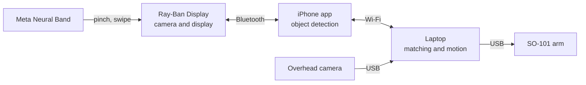

# LookGrab

Look at an object on the table, pinch your fingers, and a robot arm picks it up and hands it to you.

LookGrab is an open-source robot arm you control by looking and pinching, with nothing to hold and nothing to type. Meta Ray-Ban Display glasses see what you're facing, and the Meta Neural Band wristband picks up the pinch. The arm is the open-source SO-101. All of the parts together cost just under CA$2,000.

The project is at the design stage and nothing has been built yet. For now the repository holds the plan and a priced parts list. Code and CAD files will be added as the build goes on.

## Why

Telling a robot which object to pick up usually means a controller, a touchscreen or a typed command. LookGrab tries something more direct: you look at the object and pinch. The glasses and wristband that make this possible are now consumer products.

The application with the most to gain is accessibility. For someone with limited reach, such as a wheelchair user with limited shoulder movement, a phone or a remote at the far side of a table often means asking someone else to pass it. Wheelchair-mounted assistive arms can do this, but they have been quoted at over $40,000 ([NIBIB](https://www.nibib.nih.gov/sites/default/files/R-ARM.pdf)). Research at the University of Utah, funded by Meta, found that wrist muscle signals could still drive a virtual hand for people who couldn't extend their fingers ([Meta](https://www.meta.com/en-gb/blog/university-of-utah-accessibility-research-meta-neural-band/)). Whether the Neural Band's pinch works as well for those users is one of the questions this project will test.

Choosing objects for a robot by looking at them is not a new idea. A 2018 system built from eye-tracking glasses, a depth camera and a robot arm completed 96% of its pick-and-place tasks ([arXiv:1809.08095](https://arxiv.org/abs/1809.08095)). It ran on lab equipment. LookGrab tests whether off-the-shelf consumer hardware can now do the same job at a small fraction of the cost, with every design file published.

## How it works



1. The iPhone app streams video from the glasses and runs an object detector on it. The glasses have no eye tracking, so you aim with your head, like a red dot sight. The object behind the display becomes the candidate.
2. A dot and a label appear over the candidate in the glasses' display. Swiping moves the dot to the next object. A pinch locks it, and the dot stays on the object while the arm works.
3. A camera above the table finds the same object. Printed ArUco markers on the table turn its position in the image into table coordinates.
4. The arm reaches down, grips the object and carries it to a fixed handover point at table height.
5. When the user pinches again, the gripper opens. A pinch while the arm is moving stops it.

The first version uses scripted grasps. A learned grasp policy, trained with [LeRobot](https://github.com/huggingface/lerobot), comes after the scripted version works end to end. [docs/design.md](docs/design.md) explains each of these choices.

## Hardware

| Part | Role | Approx. CAD |
|---|---|---|
| Meta Ray-Ban Display with Meta Neural Band | Camera, in-lens display, gesture input | 1,149 |
| SO-ARM101 Pro servo kit | 12 V follower arm, plus a leader arm for recording demonstrations | 350 |
| 12 V 5 A power supply | Powers the follower arm | 30 |
| PLA filament, 2 kg | Arm parts and custom mounts | 40 |
| USB webcam and wrist camera | Overhead and wrist views | 82 |
| Emergency stop button | Cuts power to the arm | 38 |

With shipping and 13% HST the total comes to CA$1,965. Sources and notes for every line are in [hardware/bom.csv](hardware/bom.csv). You also need an iPhone on iOS 17.2 or later, a laptop and access to a 3D printer.

## Testing plan

Ten light household objects, set out four to six at a time in five layouts, for 50 trials:

| Measure | Target |
|---|---|
| The confirmed object is the one the user meant | 90% |
| The overhead camera finds the same object | 95% |
| Pick and handover succeed | 80% |
| Time from confirming to handover | 25 s or less |
| The arm stops on a stop pinch or the emergency stop button | Every time, within 0.5 s |

The full protocol is in [docs/evaluation.md](docs/evaluation.md). Testing with people who have limited hand mobility will only start after ethics approval.

## Safety

The arm runs on small hobby servos and moves slowly. It hands objects over at table height, away from the face. Software limits its speed and the space it can reach, and a latching emergency stop button cuts its power. [docs/safety.md](docs/safety.md) goes through each hazard and how it is handled.

## Roadmap

- [ ] Print, assemble and calibrate both arms in LeRobot
- [ ] iPhone app showing the glasses' camera feed and a test dot on the display
- [ ] Test how well a calibrated dot lines up with real objects
- [ ] Object detection and the selection dot
- [ ] Neural Band confirm and stop
- [ ] Overhead camera calibration with ArUco markers
- [ ] Matching objects between the glasses' view and the overhead view
- [ ] Scripted pick and handover
- [ ] 50-trial evaluation
- [ ] Learned grasp policy

## Repository layout

```
docs/       design notes, test plan, safety
hardware/   bill of materials, wiring, custom parts
```

The iPhone app will live in `app/` and the arm control code in `robot/`.

## License

Software is released under the Apache License 2.0 ([LICENSE](LICENSE)). Hardware designs in `hardware/` are released under the CERN Open Hardware Licence v2, Strongly Reciprocal ([hardware/LICENSE](hardware/LICENSE)). Documentation is released under [CC BY 4.0](https://creativecommons.org/licenses/by/4.0/).

## Built on

- [SO-ARM100 and SO-101](https://github.com/TheRobotStudio/SO-ARM100) by The Robot Studio and Hugging Face
- [LeRobot](https://github.com/huggingface/lerobot) by Hugging Face
- [Meta Wearables Device Access Toolkit](https://wearables.developer.meta.com/docs/develop/)

## Author

Ethan Zhou, Western University
