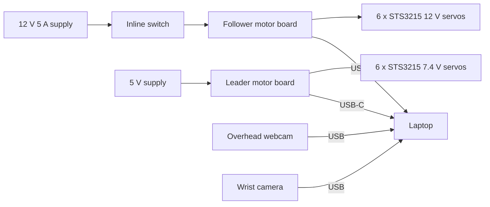

# Hardware

## Parts

The full list with prices and sources is in [bom.csv](bom.csv). Prices were checked in October 2026, and any line marked "estimate" still needs a quote.

## Arm

LookGrab uses the SO-101 arm from the [SO-ARM100](https://github.com/TheRobotStudio/SO-ARM100) project, which is released under Apache-2.0. Its parts are printed from the upstream STL files using the print settings in that repository.

The servos come from the SO-ARM101 Pro kit. The follower arm, which does the picking, uses 12 V STS3215 servos rated at 30 kg·cm. The leader arm uses 7.4 V servos and is only plugged in when recording demonstrations for the learned grasp policy.

## Wiring

The servos on each arm are daisy-chained on one bus. The inline switch sits on the follower arm's 12 V line, so it cuts power to the moving arm without touching the laptop or the cameras.

## Custom parts

These will be designed in OpenSCAD and published in this folder under the CERN-OHL-S v2 licence.

| Part | Purpose |
|---|---|
| Overhead camera mast | Clamps to the table and holds the webcam above the workspace |
| ArUco table mat | Printable sheet with four markers and an outline for the arm's base |
| Handover cradle | Marks the handover point and catches an object released early |
| Wrist camera mount | Only needed if none of the upstream mounts fit the camera we buy |
